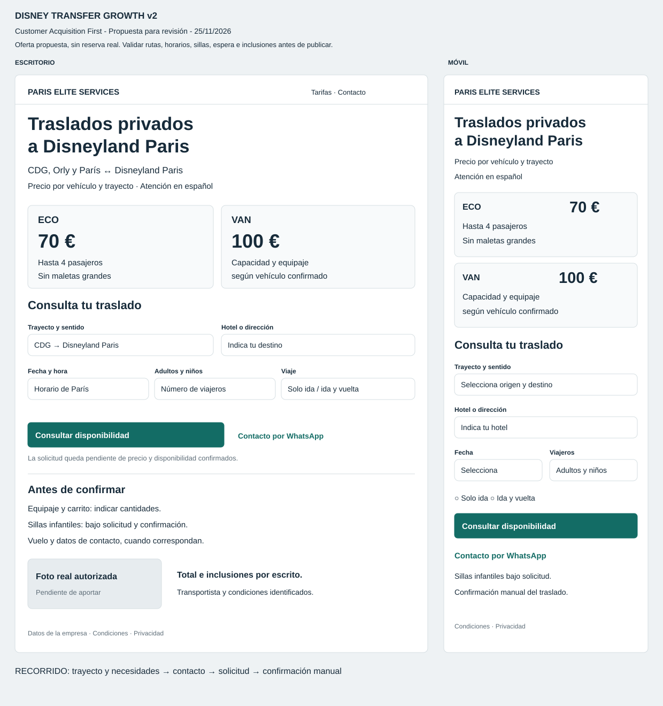

# Disney Transfer Growth v2.0 — Customer Acquisition First
25/11/2026 · Europe/Paris · **PENDIENTE de aprobación; R0 documental.**
Plan IDs: CUSTOMER-ACQUISITION-DISCOVERY-01; SEO-DISNEY-DOMAIN-DISCOVERY-01 (conservado).
Prioridad: conseguir reservas propias antes de automatizar su distribución. Este documento reemplaza las conclusiones comerciales anteriores; su historial sigue disponible en Git.
Autorización: discovery, auditoría y PLAN. Sin implementación, anuncios, contactos, cambios de precios, pagos, DB, conexión de cuentas, merges ni despliegue.

Diseño conceptual; no modifica tarifas reales. Fotografías propias/autorizadas pendientes; sin reseñas ficticias ni afiliación oficial con Disney.

## 1. Oferta y alcance
Familias residentes en España que visitan Disneyland Paris, sin enfoque VIP. Estacionalidad, antelación y sensibilidad al precio son hipótesis por validar.
Conservar eliteparistransfer.com, Paris Elite Services, páginas, servicios e idiomas existentes. Landing española independiente, móvil, información práctica y una acción: consultar disponibilidad.
Oferta propuesta por vehículo/trayecto: **ECO 70 EUR**, hasta 4 pasajeros incluyendo niños, sin maletas grandes; **VAN 100 EUR**, capacidad/equipaje según vehículo confirmado.
DISNEY-PRICE-SCOPE-01 debe validar CDG/Orly/París, ambos sentidos, hoteles, horarios, espera, retrasos, sillas, carrito, suplementos, impuestos y cancelación antes de publicar.
Atención en español no equivale a garantizar conductor hispanohablante. Sin promesas de flota, capacidad infantil, gratuidad o respuesta no comprobadas.
Separar ejecución propia e intermediación: identificar operador, cobro y facturación en cada circuito. Modelo económico, contactos prioritarios y estrategia competitiva se entregan privadamente, fuera del repositorio público.

## 2. Auditoría y reutilización
Booking main auditado: [94baae0](https://github.com/geinersito/paris-luxe-journey/commit/94baae0c228d8ad9cab40b5ab2bb9a273520a100); seis SSOT presentes/no vacíos. [Discovery inicial conservado](https://github.com/geinersito/paris-luxe-journey/blob/a0a0f36abfb66607a3cf338ec389cc305979300b/docs/audits/DOMAIN_DISNEY_DISCOVERY_2026_11_25.md).
Reutilizar BookingForm/useBookingForm/useBookingPrice, destinos Disney, ida/vuelta, validación, blog familiar y analytics existentes. Nueva ruta exacta /es/traslados-disneyland-paris: no asumir prefijo español global.
Los fallbacks del pricing no acreditan tarifas ECO/VAN. El formulario genérico anuncia equipaje distinto de ECO: resolver esta contradicción antes de reutilizarlo.
submit-booking-request guarda public_booking_requests/pending_review y prepara notificación; no prueba creación de servicio ERP. [Contrato ERP](../integrations/erp.md): **NOT LIVE**, webhook canónico sin ingest. No reactivar integración archivada.
Producción observada 25/11: /booking ofrece solicitud/revisión humana; /sitemap.xml muestra vista 404. No se envió formulario. Esto no prueba HTTP 404, desindexación ni versión desplegada de funciones; Search Console no auditado.
ERP main [4c6e624](https://github.com/geinersito/paris-dispatcher/commit/4c6e6248700d40cae6a765e3e5e261bcfd52f819): propuestas/portal/outbox/ledger son referencias reutilizables; SSOT check PowerShell OK.
La comisión existente registra una obligación pagadera al intermediario y payout_sent. No acredita facturar/cobrar una comisión al conductor: auditar cuentas a cobrar en R2 separado, sin invertir signos del ledger existente.
[Dispatch Live #1465](https://github.com/geinersito/paris-dispatcher/pull/1465) se conserva, diferido a P3. Sin VPS ni Telegram ahora; ninguna asignación automática.

## 3. Captación y demanda
P0: recomendaciones de clientes propios, contenido útil, comunidades con reglas verificadas, SEO y colaboraciones permitidas. No contactar a terceros en este discovery; respetar carteras confiadas y procedencia comercial.
El mapa privado cubre operadores de referencia, blogs, foros, Facebook, Instagram/TikTok/YouTube y agencias. Distingue audiencia verificable, actividad fechada, contacto profesional, recomendación editorial y afiliación; coste no publicado queda desconocido.
No confundir seguidores globales con residentes en España, lecturas acumuladas con audiencia mensual, código descuento con contrato exclusivo ni coincidencias de nombres con relaciones empresariales.
[Keyword Planner](https://support.google.com/google-ads/answer/7337243?hl=es-ES), consulta 25/11: España, Spanish, Google, nov-2025/oct-2026; seis semillas, 36 ideas. Exportación conservada privadamente, sin activar publicidad/facturación.
| Consulta | Promedio mensual mostrado | Puja superior de página, baja–alta |
|---|---|---|
| traslado disneyland paris | 10–100 | 0,54–1,73 EUR |
| transfer cdg disneyland | 10–100 | 1,02–4,73 EUR |
| orly disneyland | 10–100 | 0,55–2,07 EUR |
| traslado paris disneyland | 10–100 | 0,47–1,98 EUR |
| transfer disneyland paris | 10–100 | 0,73–2,37 EUR |
| traslado orly disney | 100–1.000 | 0,42–1,63 EUR |
Son intervalos estimados, no personas, reservas ni CPC real. CSV devuelve valores representativos 50/500 y meses vacíos: no tratarlos como conteos exactos ni sumar variantes. **Estacionalidad mensual no demostrada**; no publicar campaña para desbloquear datos.
Precios anunciados reconsultados 25/11: [Paris Disney Ride](https://parisdisneyride.com/) CDG 75/100 EUR, Orly y París 80/120; [Paris Shuttle](https://www.parisshuttle.es/preciosdisneyshuttle.php) CDG/Orly 95/110; [StarClass](https://starclassparis.com/es) CDG/Orly 120, París 130. Grupos/equipajes/sillas/espera difieren: ECO no es una comparación equivalente con maletas incluidas; VAN 100 coincide con una oferta CDG, no es precio mínimo demostrado.
Google Business Profile: [empresas de generación de leads no elegibles](https://support.google.com/business/answer/13763036); revisar actividad presencial real y perfil existente antes de recomendar alta. Sin dirección ficticia ni perfil nuevo ahora.

## 4. Validación jurídica y económica P0
El cobro/factura del conductor no descarta obligaciones de centrale de réservation. Validar clasificación, declaración/renovación anual, RC profesional y responsabilidad con profesional competente: [Ministerio francés](https://www.ecologie.gouv.fr/politiques-publiques/taxi-vtc-vmdtr-cpa-reglementation-transports-publics-particuliers-personnes), Code des transports L3141-2, L3142-3/4.
Validar mandato, contrato pasajero/conductor, control de habilitaciones/seguros, identidad del prestador, condiciones de cancelación, mediación y privacidad. No se ha verificado la situación administrativa del propietario.
[BOFiP](https://bofip.impots.gouv.fr/bofip/323-PGP.html/identifiant=BOI-TVA-CHAMP-10-10-40-40-20210813): actuar en nombre ajeno o propio tiene tratamientos distintos; la etiqueta frais de gestion no decide por sí sola. Determinar bases fiscales, facturación y régimen con asesor.
Matriz privada separa ingreso/cobro de intermediación, ejecución propia, gastos, incidencias y adquisición. Comisión no equivale a beneficio neto; no financiar publicidad con facturación del conductor ni presumir valor de vida futuro.

## 5. Recorrido y métricas
Solicitud: trayecto/sentido; fecha/hora París; vuelo si corresponde; hotel/dirección; adultos/niños; equipaje/carrito/sillas; vuelta condicional; contacto. Recoger solo datos necesarios, con condiciones e identidad claras.
Resumen de categoría/total/inclusiones; revisión humana; “solicitud recibida” separada de “reserva confirmada”. Reutilizar contrato actual solo tras auditar payload, prefill, persistencia y errores; no checkout inactivo.
Medir consultas únicas/cualificadas, confirmadas, realizadas, fuente propia, ida/vuelta, CAC, ingresos de gestión devengados/cobrados, costes reales, reseñas auténticas y recomendaciones. Clic WhatsApp ≠ reserva; deduplicar y respetar consentimiento/PII.
Objetivos iniciales exploratorios: 4/5 usuarios entienden oferta/precio/acción; cero discrepancias en casos sintéticos; tasa de confirmación y CAC sin meta inventada. Core Web Vitals y SEO tras ruta aprobada; sin prometer SLA nuevo.

## 6. Roadmap propuesto; cada micro-PR <200 líneas netas y ≤4 archivos
| Prioridad / ID | Archivos previstos y alcance | Riesgo / estimación |
|---|---|---|
| P0 CUSTOMER-ACQUISITION-DISCOVERY-01 | Este audit, SVG, IMPROVEMENTS, STATUS; mapa/economía/evidencia privados | R0, 180–199 netas |
| P0 LEGAL-INTERMEDIATION-SCOPE-01 | Checklist/resumen sin datos sensibles + dos SSOT; validación externa separada | R0, 50–90 |
| P1 DISNEY-PRICE-SCOPE-01 | Matriz publicable por ruta/categoría + dos SSOT; ningún runtime | R0, 50–90 |
| P1 Landing española | src/pages/DisneyTransfers.tsx, src/App.tsx + dos SSOT; presentación/ruta | R1, 140–190 |
| P1 Solicitud/SEO | Formulario o adaptador; activos SEO/runbook + SSOT; dividir por responsabilidad | R1, 100–190 cada una |
| P1 Comunidades/colaboraciones | Contenido práctico y registro privado; permisos/contactos solo tras autorización | R0 documental, 40–80 |
| P2 Atribución/conversiones | src/lib/analytics.ts o adaptador existente + SSOT; eventos sin PII | R1, 80–150 |
| P2 Red/comisiones | PLAN exacto previo: colaboradores, cuentas a cobrar, comisión e idempotencia | R2, 100–190 por slice |
| P3 Dispatch Live | #1465 conservada; demanda/capacidad justifican nueva revisión de canal | R1 prototipo / R2 operativo |
No encajar un cambio financiero en R1: pricing efectivo, pagos, ledger e ingest ERP requieren PLAN R2 propio. Alcance exacto y conteo se validan antes de cada implementación.

## 7. Aceptación, Evidence Pack y decisión
Discovery aceptable: dos PR draft alineadas; fuentes/fechas y límites documentados; export Planner con filtros; matriz privada coherente; diferencias pagadero/cobrable y NOT LIVE explícitas; SVG sin promesas; SSOT y diff revisados.
Implementación futura: aprobación propietario/CTO, precio/operador/condiciones validados, diseño aceptado y plan exacto; después CI/lint/TypeScript/build y smoke móvil/escritorio, ida/vuelta, equipaje/sillas, duplicados y fallo sintético de envío.
Evidence Pack: SHAs anteriores, SSOT, observación pública, exportación y fuentes privadas; verificar diff final y lectura remota. No se prueba producción financiera ni funnel con un envío real. R0 documental no requiere tests de runtime.
**Operations & Revenue Radar:** mayor oportunidad: adquisición propia medible; conversión: tarifa/condiciones comprensibles; margen/cashflow: cobro de gestión verificable; riesgo: clasificación jurídica y economía de captación; desperdicio: Telegram antes de demanda; revisión: evidencia de reservas realizadas, no métricas de vanidad.
**Next Best Slice: CUSTOMER-ACQUISITION-DISCOVERY-01 — R0 documental.** PLAN consolidado para revisión. HOLD para implementar; completar validación jurídica, alcance de precios y evidencia comercial antes de tráfico pagado o automatización.
